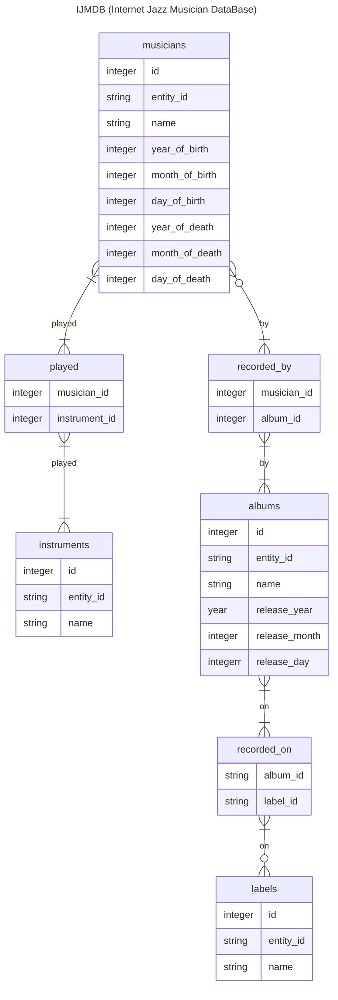
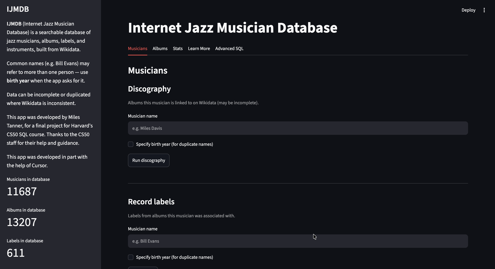
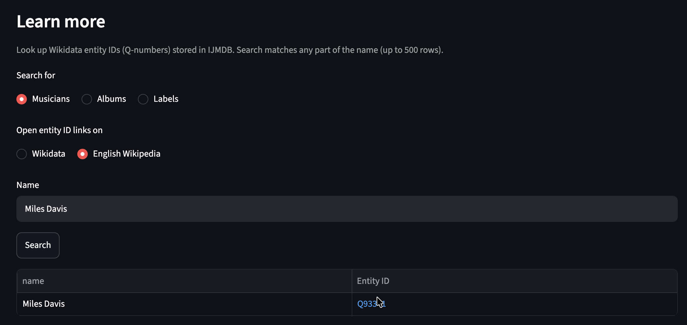

# CS50 SQL Final Project - Miles Tanner

Please check out the video here:
[https://youtu.be/TR439ZfOyf8](https://youtu.be/TR439ZfOyf8)

## Abstract

**My goal:** Implement a searchable, interrelated database of jazz musicians not unlike the IMDB, but for the musicians and records in the jazz genre (or at least those listed as "jazz" musicians/records on Wikipedia).

**Scope:** This database will implement tables for simple "IMDB"-like questions for people, works and institutions in the music industry, specifically Jazz. It will include information found in the free repository of data at WikiData, the database that powers Wikipedia. I won't be including entries that Wikipedia has a significant amount of missing information for.

**Data Sources**: We will use information from Wikipedia, specifically it's structured data repository, Wikidata. I used its APIs first to return lists of all the URLS to the information I need, and then the information related to them.
For reference, archives of the data eventually used are at:

- [flatfiles.zip](flatfiles.zip)
- [ids.zip](ids.zip)

**Entities:**

- Individual people or 'musicians'
- Invidual albums
- Record Labels
- Instruments that musicians might play

**Relationships:**
There are tables for:

- Relating musicians to
  - the instruments they were known to play
  - the albums they recorded
- Relating albums to:
  - the record labels associated with that record

**Optimizations:**

There are indexes for:

- Searching for _albums_ by **name**
- Searching for _musicians_ by **name**

- Searching for _albums_ by name and **year**
- Searching for _musicians_ by name and **year**

The two most common conditions I see potential users searching for are names and years, so indexes on these made sense.

I included name and year in the indexes as there were a few cases where I had to search for unique items among duplicates by name _and_ year.
Those indexes cover both queries: on just years, and names _and_ years.

**Limitations:**

This database relies on Wikidata, which sometimes has too much information, and sometimes too little.
However, it's data standardization is very good, and nowhere else is there a such comprehensive knowledge base that can be accessed programatically, for free - especially on topics like this.

**Some important data is missing** - and some entries are not representative of people that most users want to query about.

Wikidata also is inconsistent about linking _all_ performers to an album, where the personnel listing of a record gives much insight into the record and is something that is generally interesting to the average Jazz fan.
Occaisonally only the bandleader is linked - and sometimes the whole band is linked.

Wikidata also includes redundant 'entities', to deal with a lack of information or vague information, which I had to accept and read in to the DB. Many saxophonists have 'saxophone' and their primary saxophone _(soprano, alto, tenor, etc.)_ listed, for example.

**On collecting data and moving it to the DB** - Wikidata's servers are generally fairly fast and support batched API requests. Luckily, I was not working with too much data - but scaling is always tricky and could be tricky here, due to the inconsistent information. SQLAlchemy and Pandas made the actual uploading extremely fast. (An order of magnitude more time was spent writing Python and wrangling data than actually uploading it - but a valuable learning experience for the future.)

Certain pieces of information I would have liked to include - such as birth place _(Jazz is a traditional music of the United States and thus in the early days, fairly regional)_ were tricky because Wikidata's linked data model means finding connections through hyperlinks are very easy, but API requests return Wikipedia's own entity ID's (essentially, URLS). I haven't developed the script yet to recursively search the responses, making new requests until the actual text data, which I can read in, is found.

Other than that - this database is fairly small as data sets go, and extremely fast to search even without indexes. Can't complain too much :).



**Dependencies:**

Finally I used the latest versions (as of October 2026) of all of these tools, in large part or small part.

- Python 3.14 and it's standard library
- VS Code
  - Various language extentions relating to Python
  - Implementation of Juptyer Notebooks in VS Code
- Python packages such as:
  - requests
  - sqlalchemy (using pymysql)
  - pandas
  - numpy
- MySQL Server Community edition
- Homebrew (to install and start MySQL Server)
- DBeaver Community edition (for easy visualizing)

And for some questions and bug fixings:

- Ollama (running Gemma 4)
- Gemini 3 Pro (for the really tricky stuff.)

Finally, for the web app I made:

- streamlit
- pandas
- sqlalchemy
- pymysql
- python-dotenv

(Made with Cursor Composer 2.5)

## Modules

Tasks included:

- Requesting and writing data to intermediate files + cleaning it using Python
- SQL to create tables/relations
- Python + SQL to insert data into the tables.

I implemented a simple package [`wiki_tools`](wiki_tools/), to help me get a lot of this work done.

### Data Requesting and Storage

A module [`wiki_tools/web_queries.py`](wiki_tools/web_queries.py), implements a simple set of functions to submit GET requests to Wikidata's end points at
[https://query.wikidata.org/sparql](https://query.wikidata.org/sparql) and [https://www.wikidata.org/w/api.php](https://www.wikidata.org/w/api.php) utilizing the _requests_ library.

**This was done in two phases:**

**First,** requesting all links refering to a certain set of parameters. This was done with Wikidata's `SPARQL Query Service`. Extremely fast at searching for entity ID's - quite slow at everything else.

**Then,** sending a simpler and faster GET request to the Wikidata server proper, getting back structured JSON for a given WikiData page.

### wiki_tools.web_queries Documentation

---

**The global variables are:**

#### SPARQL\_ENDPOINT

Wikidata linked data endpoint, MediaWiki

#### MEDIAWIKI\_ENDPOINT

Wikidata's Query Service Endpoint

#### HEADERS

Headers requrired for requests.

#### FILE\_FIELDS

Specific file fields needed for different objects.

**The operations are:**

#### get\_batch\_data

```python
def get_batch_data(mode: str, infile: str, outfile: str) -> bool
```

Processes batches of Wikidata entitites from the infile.
Writes their data to the outfile.
Takes a 'mode' param which decided which data will be retrieved and returned.

**Arguments**:

- `mode(str)` - the type of data/entities to be processed. (Essentially an enum, 'musician', 'album' or 'name_only', used for labels and instruments)
- `infile(str)` - a file path to file containing Wikidata Entity links.
- `outfile(str)` - a file path to write final output to.

#### get\_ids

```python
def get_ids(query: str) -> list | None
```

Pass in a query to Wikidata's SPARQL service,
returns back the Entity ID's that satisfy the constraints as JSON.

**Arguments**:

- `query(str)` - The URL containing the to be sent to the SPARQL_ENDPOINT.

**Raises**:

- `RequestException` - Raised whenever a non-200 OK code is returned.

#### get\_page\_from\_id

```python
def get_page_from_id(ids: str) -> list[dict] | None
```

Accept a list of Wikidata entity pages, send a request, return the JSON in a list.

This function will silently handle 429 responses, and wait the appropriate amount.
Anything else will print the status code and return None.

**Arguments**:

- `ids(str)` - the ids to be passed into the GET request for the MEDIAWIKI_ENDPOINT.

#### entity\_to\_item

```python
def entity_to_item(entity: dict, mode: str) -> dict
```

Accepts a Wikidata Entry, returns the necessary properties as dict, where
operating modes decide which properties are used.

"musician", "album", "name-only" modes accepted.

**Arguments**:

- `entity(dict)` - a nested JSON object returned by MEDIAWIKI_ENDPOINT.
- `mode(str)` - the operating mode (same as the mode in the top level function, get_batch_data)

#### link\_to\_entity

```python
def link_to_entity(link: str) -> str
```

Returns an entity ID for every Wikidata link passed in.

#### link\_generator

```python
def link_generator(file: str) -> Iterator
```

Takes in a file argument and creates a list of lists containing entity ids in groups of 50, returns the list as a generator.

**Arguments**:

- `file(str)` - a file containing many Wikdata links to read in

#### convert\_dates

```python
def convert_dates(date: str) -> str
```

Turns the date formats returned by Wikidata into a cleaner format.

For example: +1928-04-02T00:00:00Z -> 1928-04-02

**Arguments**:

- `date(str)` - a date string to be cleaned

#### write\_to\_file

```python
def write_to_file(items: list[dict], mode: str, outfile: str)
```

Write a set of Wikidata items to a CSV for DB upload.

Presumably, these items have been constructed by calling entity_to_item().

**Arguments**:

- `items(list[dict])` - A list of items to be printed, each contained in a dict.
- `mode(str)` - the operating mode of this file, specifing the fields to be printed
- `outfile(str)` - a file path to append items to.

---

A helpful tool I used for doing this in an interactive manner is located in a Jupyter Notebook, [`wiki-query-tools.ipynb`](wiki-query-tools.ipynb).

Sample SPARQL queries I ran are written in [`notes/wiki_queries.md`](notes/wiki_queries.md). My notes on the Wikidata JSON are is in [`notes/wiki_properties.md`](notes/wiki_properties.md)

The responses from the SPARQL API are written to CSV files using the _csv_ module, containing just keys.
Then, the data relating to them is requested in batch, using the Wikidata MediaWiki API. This allows us to get the information from as many 50 pages at once as JSON.
Various functions process these JSON objects, and write them to another CSV. Those files are in [flatfiles.zip](flatfiles.zip).

An alternative is to use the HTML data from pages - but this was not viable for a larger scale and deeper information gathering.

---

### Data Cleaning and Entry

Wikidata's API often returned multiple items for things like "instrument" or "label" for a given album, musician etc.
This would be hard to insert into the database right away - and then later separate as a junction table.

I did this work beforehand with some small workarounds:

Rather than make the csv's with the actual records I wanted to insert redundant (an extra row for each instrument that a musician might have played), I decided to temporarily store these items as a string. I parsed these strings as lists and inserted them into csv's which acted more like junction tables; with redundancy, but only with the relationships between keys represented.

These were then read into Pandas Dataframes for some final cleaning, extracting of data and error checking.
These dataframes could then be uploaded directly to the database through the `Pandas.DataFrame.to_sql` function, using `SQLAlchemy` module and the `PyMySQL` driver to export directly from the dataframe to tables.

I had a particularly hard time with dates - Wikipedia returned unknown parts of dates as '00' which caused loads of errors when trying to get these strings to be Pandas 'datetime' objects or MySQL 'DATE' data types. I split out these strings into separate years, months and days, letting those columns be NULL whenever there was no information. It may make a future front end more flexible in terms of displaying dates back to users - I probably should have done it earlier than the last step.

The tools used to do this work are in [`wiki_tools/data_insert.py`](wiki_tools/data_insert.py), again making heavy use of the _csv_ library along with _pandas_, _NumPy_ and _SQLAlchemy_ to do most of the heavy data lifting.

I did half of the work by running the 'insert' module as a script, and the other half by writing some high level functions/wrappers of the functionality of pandas in an Jupyter Notebook at [`data_insert.ipynb`](data_insert.ipynb), so I could visualize and check my work more effectively.

### wiki_tools.data_insert Documentation

---

**The operations are:**

#### make\_junction

```python
def make_junction(infile: str, outfile: str, fieldname: str) -> None
```

Make a "many to many" relationship or junction table as a CSV.

**Arguments**:

- `infile(str)` - a filepath to a csv with id's and items
- `outfile(str)` - a filepath to a csv to be written to.
- `fieldname(str)` - the field that is to be searched for lists

#### list\_parse

```python
def list_parse(entry: dict) -> dict
```

Take a dictionary, with an id and a string of items,
return the same but with a Python list rather than a string.

**Arguments**:

- `entry(dict)` - a dict with 'entity_id' as it's Wikibase ID, and an 'items' str.

#### make\_list

```python
def make_list(str: str) -> list
```

Take a string that looks like a list, returns it as an actual list.

#### update\_lists

```python
def update_lists(file: str, field: str)
```

Updates a csv with strings that contain multiple items to contain just the first item.

**Arguments**:

- `file(str)` - a file path to read from
- `field(str)` - the field to read into

#### flatfile\_to\_df

```python
def flatfile_to_df(file: str,
                   columns: list,
                   dates: list | None = None) -> pandas.DataFrame
```

Take a flat file that contains all record information returned by Wikidata requests, return a pandas DataFrame.

Splits out any dates into columns of year, month, day. All of datatype Int64, the nulllable integer type.

**Arguments**:

- `file(str)` - a file to be imported into a DF
- `columns(list)` - a list of columns that are included.
- `dates(list)` - a list of those columns which are dates

#### df\_to\_db

```python
def df_to_db(df: pandas.DataFrame, table: str)
```

Wraps the to_sql pandas function to automatically connect with the MySQL DB.

Sets if_exists = 'append' as to never delete information from a table that already exists.

**Arguments**:

- `df(pandas.DataFrame)` - the dataframe to be inserted
- `table(str)` - the name of the table to be created or appended to.

## Database Schema and Querying

The database is implemented in MySQL. _(I found installing it via Homebrew was the easiest.)_
The schema is laid out in [`schema.sql`](schema.sql) with all of the records, and junction tables that connect them. Stored procedures are also in this file.
Common/useful queries on the database and the insertion statements are in [`queries.sql`](queries.sql). A dump of all backend information collected by the server is at [`dump.sql`](dump.sql).

In addition to the tables in the entity relationship diagram at the top, I added some temporary tables to allow me to populate the junctions with my actual Database ID's rather than Wikidata's entity ID's.
INSERT INTO statements were used on the temps to get them into the main tables.

Some views on data are as follows:

- `musician_stats`: Simple, at a glance information about musicians. (Contains name, birth year, and instrument.)
- `instrument_count`: A ranking of the amount of people who play each instrument.
- `album_list`: At a glance information about who recorded what.

Indexes as mentioned in the 'optimizations' section at the top are:

- `musician_names`: on musicians.name
- `album_names`: on albums.name
- `albums_by_year`: on albums.name and albums.release_year
- `musicians_by_birth_year`: on musicians.name and musicians.year_of_birth

Some stored procedures help gain quick info on the data in aggregate and the db itself:

- `table_counts()`: shows the COUNT(*) of all record tables
- `name_counts(p_table_name, item_name)`: shows the amount of items in 'p_table_name' with 'item_name', useful for checking if a query will return just one or multiple items in the case of redundancies or common names.
- `insert_from_tmp`: automates the process of inserting rows into junction tables from temporary tables - with the correct database codes. (see [`queries.sql`](queries.sql) for those inserts)

**I didn't see much use for triggers** as I didn't implement soft-deletions or anything of the like, but I'm sure that if I expand the DB and connect it to an app or website that I could run into a situation where I need it.

## Interacting

I found that `DBeaver` - an open source database GUI was quite easy to setup on my server, and allowed me to see and interact with the data slightly faster. It's 'community' version is totally free, just as MySQL.

I definitely want to show this off to friends - so I decided to go modern and whip up a little tool for non-technical users to query the DB by asking Cursor Composer to help me make a frontend in `Streamlit`, a pure-Python web framework, used for data driven apps such as this.

The entire subrepo for that app is in [`frontend`](frontend/). As I go - I'll probably replace the semi-slop [README](frontend/README.md) with my own reading of the code. Luckily Streamlit is a fairly straight-forward framework and quite readable.

The subfolder is using a virtual environment using `venv` and can be started up using the included shell script [`start_ijmdb.sh`](frontend/start_ijmdb.sh). It boots up the MySQL server using `brew services run` (as I installed via Homebrew) and logs in a user that is specifcally for the app, and can only run SELECTs on the DB. Then it starts the environment and launches the web app using `streamlit run`.

And you're off to the races! It's perfect for showing it off to my friends and family.




You can:

- **Run some parameterized queries using prepared statements**, with the user inputting the person they want to find by name
- **Run some preset queries that I found interesting** like those in [`queries.sql`](queries.sql).
- **Learn more about any entity** by using the entity_id of any entity to construct a link to Wikidata or redirect right to Wikipedia for any given entity.
- **Run arbitrary SELECT SQL statements** in the advanced user tab.

## Summary

And that's my database! I learned a lot by trying to go for a slightly larger scale than we were focusing on in the course - I really had to know my stuff, and pick up some new skills on the way to collect and wrangle the information.

**Thanks to Carter Zenke and the whole CS50 team at Harvard!** It was a lot of fun - and a great challenge to put this together.
I plan to use these skills to hopefully work in the music industry, which is so oriented around data in various forms and fields of the industry; **to implement good, logical systems** (even when information around music, rights, streaming etc.. are extremely fragmented and larger systems are in conflict) that can work for the average user and musician, and **to think critically about data science in general,** especially how it relates to its applications in the operations of companies - but also things like social media algorhithms, which so often drive music engagement and publicity.
