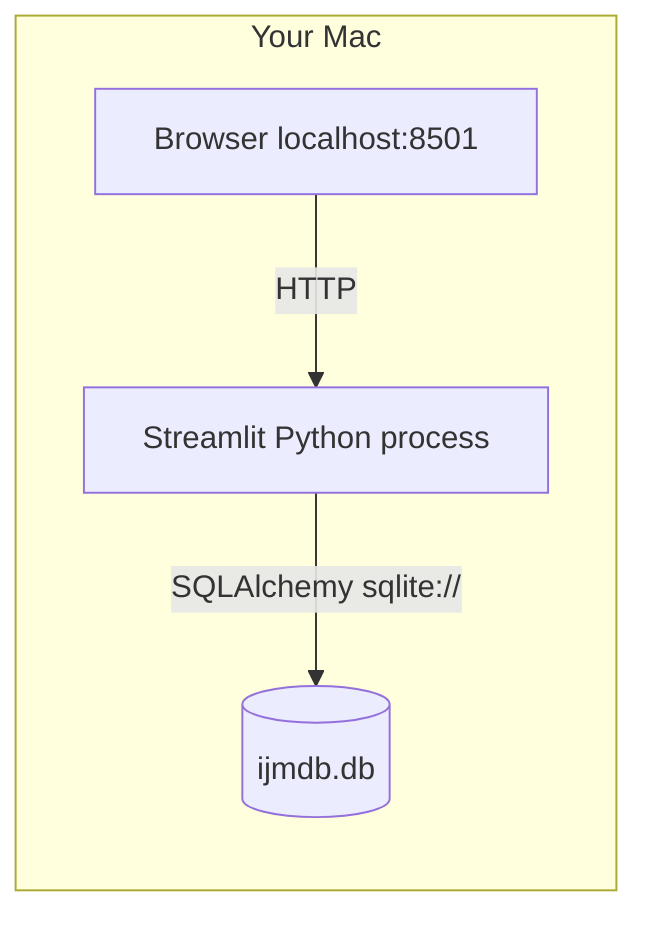

# Local Streamlit app for IJMDB

## Implementation status

The app is implemented in this folder:

- `app.py`, `db.py`, `queries/guided.py`
- `.streamlit/config.toml`
- `start_ijmdb.sh`, `README.md`

Run with `./start_ijmdb.sh` or `streamlit run app.py` once `../ijmdb.db` exists.

---

## What you are building

The parent project provides [`schema.sql`](../schema.sql), [`ijmdb.db`](../ijmdb.db), [`queries.sql`](../queries.sql), and [`inserts.sql`](../inserts.sql). The **frontend** is a thin UI that:

1. Opens **SQLite** at `../ijmdb.db` (same machine as the browser).
2. Runs **read-only** `SELECT` queries (guided + Advanced SQL).
3. Presents guided screens for common jazz-DB questions.



**Why this works locally:** Streamlit and the database file both live on one computer. No database server, credentials, or port forwarding.

---

## Phase 0 — Prerequisites

| Step | What to verify | Why it matters |
|------|----------------|----------------|
| Database file | `../ijmdb.db` exists next to the project root | App cannot query without it |
| Schema loaded | `.tables` in `sqlite3` lists `musicians`, `albums`, etc. | Empty file = blank app |
| Views exist | `.schema instrument_count` etc. | Guided pages use views from `schema.sql` |
| Sample query | Run a statement from `queries.sql` in the CLI | Confirms data before debugging Python |

**Build path (if needed):** from project root, `sqlite3 ijmdb.db ".read schema.sql"`, load data via notebooks/`df_to_db`, then `".read inserts.sql"`.

---

## Phase 1 — Python project in `frontend/`

### Virtual environment

```bash
cd frontend
python3 -m venv .venv
source .venv/bin/activate
pip install -r requirements.txt
```

### Dependencies (`requirements.txt`)

```text
streamlit
pandas
sqlalchemy
```

---

## Phase 2 — Configuration

Connection URL is defined in `db.py`:

```text
sqlite:///../ijmdb.db
```

Paths are relative to the **current working directory** when Streamlit starts (normally `frontend/`). To use another location, edit `sqlite3_url` in `db.py` or switch to an absolute path.

No Streamlit secrets file is required for the default setup.

---

## Phase 3 — App architecture

```text
frontend/
  app.py
  db.py
  queries/guided.py
  requirements.txt
  .streamlit/config.toml
```

### `db.py`

- `@st.cache_resource` on `get_engine()` — one engine per server process.
- `run_query(sql, params)` — `sqlalchemy.text` + bound parameters.
- Returns `pd.DataFrame` for `st.dataframe()`.

Consider enabling `PRAGMA foreign_keys=ON` on connect if you add writes later (the loader in `wiki_tools/data_insert.py` already does this).

### Guided UI

Parameterized SQL lives in `queries/guided.py`, mapped to questions in `queries.sql`.

### Advanced SQL

- Reject statements that do not start with `SELECT` or `WITH` (UX guard only).
- On SQLite, `DELETE`/`DROP` from Advanced SQL would still mutate the file—treat the app as trusted local use or open the DB read-only if you need a harder guarantee.

---

## Phase 4 — Run and validate

```bash
cd frontend
source .venv/bin/activate
streamlit run app.py
```

Default URL: **http://localhost:8501**

**Checklist:**

1. App loads with no traceback.
2. One guided query returns known rows (e.g. Miles Davis albums).
3. Advanced SQL: `SELECT 1` works; destructive statements are blocked or discouraged by your guard.
4. Stop app: Ctrl+C.

---

## Phase 5 — Demo playbook

| Concern | What to do |
|---------|------------|
| Laptop sleeps | Disable sleep while demoing |
| Missing DB | Ensure `ijmdb.db` is in the project root |
| Starting the app | `./start_ijmdb.sh` |
| Browser | Open `http://localhost:8501`; fullscreen if helpful |
| Quit cleanly | Ctrl+C in the Terminal running Streamlit |

The demo URL works on your Mac while Streamlit is running and `ijmdb.db` is reachable from `db.py`.

---

## Hosting later

To deploy elsewhere, change the SQLite URL in `db.py` (or move to a hosted SQL backend with the same SQLAlchemy pattern). Schema and data can be copied as `ijmdb.db` or rebuilt from `schema.sql` + load scripts.